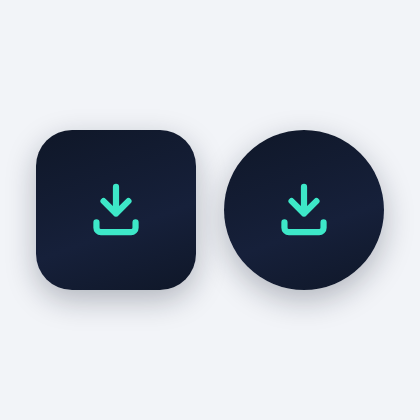
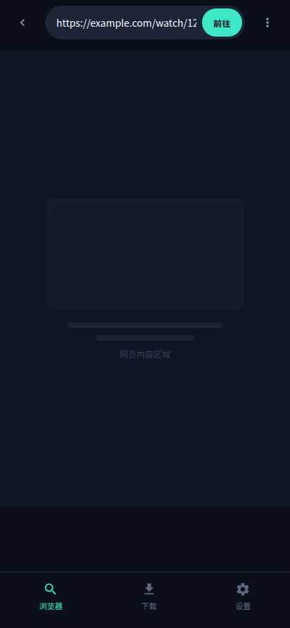
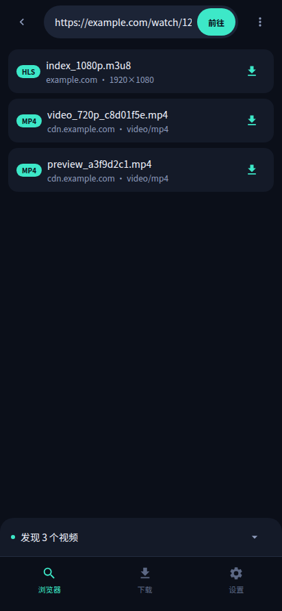
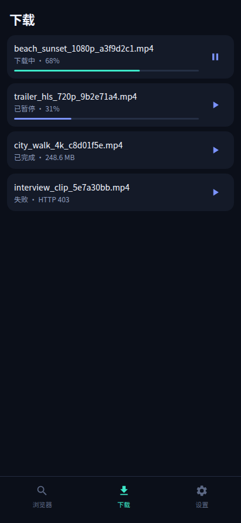
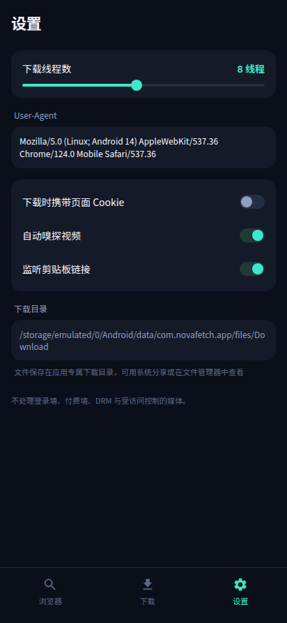

# KiruFetch

一个轻量的 Android 视频工具：内置浏览器打开网页，自动嗅探页面里的直链、HLS（m3u8）与 DASH（mpd）；多线程下载、断点续传，下完直接存进系统相册，支持批量管理与手势播放。跟随系统深浅色，内置应用内更新。

目标是只做下载这一件事。没有账号、没有广告、没有会员、没有云同步、没有统计上报。

仓库：<https://github.com/Kiru-Sama/KiruFetch>



## 截图

| 浏览器 | 发现视频 | 下载 | 设置 |
|---|---|---|---|
|  |  |  |  |

> 截图是按布局参数生成的界面预览，非真机截屏，实际显示以设备为准。

## 功能

**嗅探**

- WebView 请求拦截（`shouldInterceptRequest`），同时记录请求头
- JS 注入扫描 `<video>` / `<source>` / `performance` 资源 / 播放器 `flashvars`
- 按 URL 与 MIME 判断媒体类型：MP4 / WebM / HLS / DASH / 音频
- URL 规整与 SHA-256 去重，保留原始大小写
- 排除 YouTube / Instagram / Facebook

**下载**

- 直链：`Range` 探测、多线程分片、断点续传、失败重试、分片合并
- HLS：master/media playlist、`EXT-X-STREAM-INF`、`EXT-X-MEDIA`、`EXT-X-KEY`（AES-128）、`EXT-X-MAP`（fMP4）、`EXT-X-BYTERANGE`
- DASH：MPD 解析（SegmentTemplate / SegmentTimeline / SegmentList / 单文件），视频轨 + 音频轨分下载
- 音轨分离时下载后自动用 `MediaMuxer` 合成 MP4
- 多码率时弹出清晰度选择
- 请求头构造：过滤 hop-by-hop 头，补 Referer、UA、可选 Cookie

**管理**

- 串行下载队列，单任务暂停 / 继续 / 取消
- 下载页分「进行中 / 已完成」两栏
- SQLite 持久化，冷启动自动续传未完成任务
- 前台服务与通知栏进度，点击通知跳转下载页
- 默认存应用专属下载目录；可在设置里选择任意目录（SAF，零存储权限）

**浏览**

- 多标签页，每个标签独立 WebView 与会话
- 地址栏、前进后退、刷新、桌面模式
- 书签与历史
- 搜索引擎切换（Google / Bing / DuckDuckGo / 百度）
- 剪贴板链接提示
- 外部分享链接直接打开
- 返回键优先走网页历史

## 构建

要求：

- JDK 17
- Android SDK Platform 34
- Android SDK Build-Tools 34.0.0

```bash
git clone https://github.com/Kiru-Sama/KiruFetch.git
cd KiruFetch

# 指定本机 SDK 路径
echo "sdk.dir=/path/to/Android/sdk" > local.properties

./gradlew assembleDebug
```

产物：`app/build/outputs/apk/debug/app-debug.apk`

Windows 使用 `gradlew.bat`。

## 权限

| 权限 | 用途 |
|---|---|
| INTERNET | 访问网页与下载 |
| ACCESS_NETWORK_STATE | 判断网络状态 |
| FOREGROUND_SERVICE | 后台下载 |
| FOREGROUND_SERVICE_DATA_SYNC | Android 14+ 前台服务类型 |
| POST_NOTIFICATIONS | 下载进度通知 |
| WAKE_LOCK | 下载时保持唤醒 |

不申请任何存储权限。文件写入应用专属目录，卸载即清除。

## 技术栈

- Kotlin 1.9
- AGP 8.6 / Gradle 8.7
- compileSdk 34，minSdk 26
- OkHttp 4.12
- Coroutines
- 原生 `SQLiteOpenHelper`（不引入 Room / KSP）
- Material 3 组件

## 项目结构

```
app/src/main/java/com/kirufetch/app/
├── KiruFetchApp.kt          应用入口，恢复未完成任务
├── data/                    数据层（SQLite、数据类、搜索引擎）
├── download/                下载引擎（直链、HLS、队列、通知、合轨）
├── player/                  （预留）
├── settings/                SharedPreferences 配置
├── sniff/                   嗅探（JS 注入、桥接、类型判定、URL 规整）
└── ui/screens/              界面
```

## 使用边界

本项目用于保存用户**有权访问与保存**的公开媒体内容。

明确**不支持**：

- 绕过登录墙、付费墙
- 破解 DRM（Widevine / FairPlay / PlayReady）
- 绕过地理限制或平台访问控制
- 规避平台风控
- YouTube / Instagram / Facebook 等平台的专项解析

请遵守所在地区法律与目标网站的服务条款。使用者对自己的行为负责。

## 已知限制

- DASH 只取最高码率的一路视频 + 一路音频，不支持手动选码率
- HLS/DASH 不做直播流
- 未实现字幕下载
- 音视频合轨未做 PTS 交错，部分流可能音画不同步

## 反馈

QQ 群 **812971033**（KiruFetch反馈群）。报问题时带上版本号、机型和出问题的网址。

## 许可

[MIT](LICENSE)
